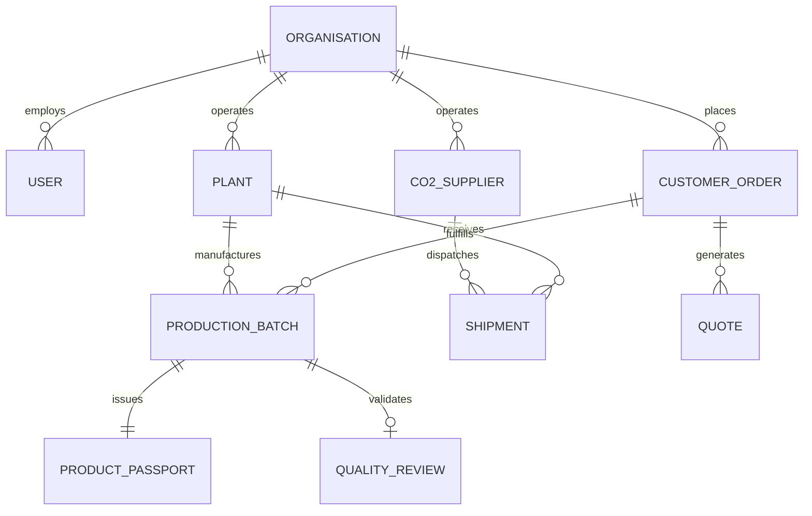

# SthiraX Domain Data Model

## 1. Entity-Relationship Overview

---

## 2. Core Domain Entities

### 2.1 `Organisation`
* `id` (String, PK): e.g. `ORG-STHIRAX`, `ORG-PRAKRITI`
* `name` (String): Legal entity name
* `type` (Enum): `STHIRAX_ADMIN`, `MANUFACTURER`, `CO2_SUPPLIER`, `CUSTOMER`, `AUDITOR`
* `registrationNumber` (String): GSTIN / CIN in India
* `status` (Enum): `PENDING_REVIEW`, `ACTIVE`, `SUSPENDED`

### 2.2 `Plant` (Precast Facility)
* `id` (String, PK): e.g. `PLT-001`
* `organisationId` (String, FK): Owning manufacturer
* `name` (String): e.g. `Hosur Pilot Precast Facility`
* `location` (String): District / City (e.g. `Hosur, Tamil Nadu`)
* `state` (String): State code (e.g. `Tamil Nadu`)
* `annualCapacityTonnes` (BigDecimal): Capacity rating
* `curingEnclosureType` (Enum): `SEALED_CHAMBER`, `AUTOCLAVE_RETROFIT`, `TARPAULIN_TENT_PROTOTYPE`
* `curingVolumeM3` (BigDecimal): Physical curing enclosure volume
* `co2StorageCapacityKg` (BigDecimal): On-site cryogenic storage buffer
* `status` (Enum): `ACTIVE`, `RETROFIT_IN_PROGRESS`, `MAINTENANCE`

### 2.3 `ProductionBatch` (Mineralization Run)
* `id` (String, PK): e.g. `batch-108`
* `batchNumber` (String, Unique): e.g. `STX-2026-B108`
* `plantId` (String, FK): Manufacturing facility
* `productId` (String, FK): Product catalogue item
* `productionDate` (LocalDate): Date of demoulding and chamber loading
* `quantityUnits` (Integer): e.g. `15000`
* `quantityTonnes` (BigDecimal): e.g. `54.00`
* `co2InjectedKg` (BigDecimal): Coriolis flow meter mass injection
* `co2MineralizedKg` (BigDecimal): Gravimetric / mass balance uptake
* `netGateToGateRemovalKg` (BigDecimal): Injected minus auxiliary emissions
* `compressiveStrength7dMpa` (BigDecimal): 7-day cube/block break strength
* `compressiveStrength28dMpa` (BigDecimal): 28-day standard break strength
* `waterAbsorptionPercent` (BigDecimal): Water absorption test percentage
* `status` (Enum): `IN_PRODUCTION`, `CURING_ACTIVE`, `CURING_COMPLETE`, `QA_PENDING`, `APPROVED`, `DISPATCHED`
* `curingDurationHours` (Integer): e.g. `14`
* `curingTempCelsius` (BigDecimal): e.g. `42.0`
* `curingHumidityPercent` (BigDecimal): e.g. `85.0`

### 2.4 `ProductPassport` (SthiraX Trace™ DPP)
* `id` (String, PK): e.g. `pass-7f9a2b4c`
* `batchId` (String, FK): Associated production batch
* `batchNumber` (String): Human-readable reference
* `productName` (String): e.g. `EcoPave Heavy-Duty 80mm Paver`
* `plantLocation` (String): e.g. `Hosur, Tamil Nadu`
* `co2InjectedKg` (BigDecimal): Injected mass
* `mineralizedCo2Kg` (BigDecimal): Fixed mass
* `netGateToGateRemovalKg` (BigDecimal): Net removal
* `bisStandardReference` (String): e.g. `IS 15658:2006`
* `testedStrengthMpa` (BigDecimal): Tested 28-day strength
* `verificationHash` (String): Cryptographic SHA-256 seal
* `publiclyScannable` (Boolean): Public QR visibility flag
* `publishedAt` (Instant): Publication timestamp

### 2.5 `CostModel` (Financial Scenario)
* `id` (String, PK): Scenario ID
* `name` (String): e.g. `Hosur Standard Retrofit Model`
* `initialInvestmentInr` (BigDecimal): Retrofit capex (e.g. ₹3,500,000)
* `annualCapacityTonnes` (BigDecimal): Rated capacity (e.g. 18,000 t)
* `expectedUtilisationRate` (BigDecimal): Operational factor (e.g. 75%)
* `conventionalSellingPriceInr` (BigDecimal): Market benchmark (e.g. ₹3,450/t)
* `sthiraxSellingPriceInr` (BigDecimal): SthiraX price (e.g. ₹3,650/t)
* `rawMaterialCostPerTonneInr` (BigDecimal): Reduced cement + aggregate cost
* `co2CostPerTonneInr` (BigDecimal): Delivered CO₂ cost
* `rejectionRate` (BigDecimal): Quality defect factor (e.g. 1.0%)
* `effectiveSaleableOutputTonnes` (BigDecimal): Computed volume
* `totalCostPerTonneInr` (BigDecimal): Computed full delivered cost
* `contributionMarginPerTonneInr` (BigDecimal): Net margin per tonne
* `contributionMarginPercent` (BigDecimal): EBITDA percentage
* `breakEvenVolumeTonnes` (BigDecimal): Break-even annual tonnage
* `approximatePaybackYears` (BigDecimal): Payback timeline in years
