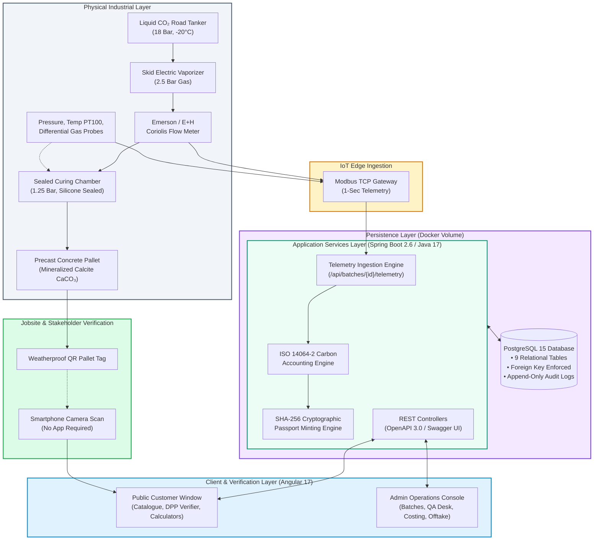
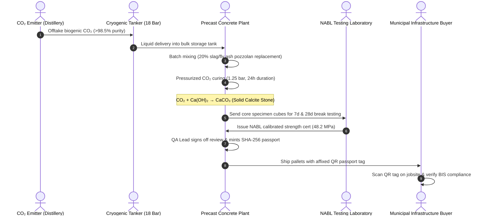
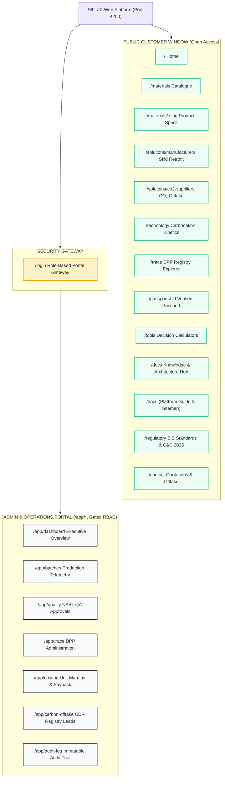

# SthiraX End-to-End Master Platform Guide & System Architecture
## Executive Manifesto, Technical Architecture, Operational Workflows & User Manual

> **Document Version**: 2.0.0-ENTERPRISE  
> **Status**: Official Reference Standard  
> **Target Audience**: Infrastructure Developers, Precast Plant Executives, Industrial CO₂ Suppliers, Site Engineers, System Architects, Carbon Auditors & General Observers.

---

## Table of Contents
1. [The "WHY": The Climate Crisis, Industrial Need & Opportunity](#1-the-why-the-climate-crisis-industrial-need--opportunity)
2. [The "WHAT": What SthiraX Does, The Science & What Happens](#2-the-what-what-sthirax-does-the-science--what-happens)
3. [Architectural Separation: Customer Public Window vs. Admin Operations Portal](#3-architectural-separation-customer-public-window-vs-admin-operations-portal)
4. [Complete Section-by-Section Website Directory & Capabilities](#4-complete-section-by-section-website-directory--capabilities)
5. [Step-by-Step Novice-Friendly User Journeys (How to Use the Platform)](#5-step-by-step-novice-friendly-user-journeys-how-to-use-the-platform)
6. [System Architecture & Flow Diagrams (Mermaid)](#6-system-architecture--flow-diagrams-mermaid)
7. [The Triple Perspective: Architect, Product Manager & Sales Director](#7-the-triple-perspective-architect-product-manager--sales-director)
8. [Glossary & Standard References](#8-glossary--standard-references)

---

## 1. The "WHY": The Climate Crisis, Industrial Need & Opportunity

### 1.1 The Global Carbon Dilemma
Concrete is the second most consumed material on Earth by mass, exceeded only by potable water. Modern civilization—roads, bridges, ports, residential towers, water aqueducts, and transit subways—is literally cast in concrete.

However, Ordinary Portland Cement (OPC)—the active chemical glue holding concrete aggregate together—is one of humanity's single greatest industrial carbon liabilities:
- **8% of Global Anthropogenic CO₂**: The global cement industry emits over 2.8 billion tonnes of CO₂ annually.
- **The Calcination Reality**: More than 60% of cement emissions are **chemically unavoidable** process emissions resulting from calcining limestone ($\text{CaCO}_3 \rightarrow \text{CaO} + \text{CO}_2$ at 1450°C in rotary kilns), meaning energy efficiency and renewable electricity alone cannot decarbonize cement.

### 1.2 The Indian Infrastructure Imperative
India is the world's second-largest cement manufacturer (~380 million tonnes annual capacity) and is undergoing the most rapid urbanization in human history:
- **National Infrastructure Pipeline (NIP)**: Programs like *Bharatmala Pariyojana*, *Pradhan Mantri Gram Sadak Yojana (PMGSY)*, *Smart Cities Mission*, and urban Metro rail networks consume billions of precast concrete paving blocks, masonry blocks, and kerbstones every year.
- **Regulatory Compulsion**: The Ministry of Environment, Forest and Climate Change (MoEFCC) and Central Pollution Control Board (CPCB) under the *Construction and Demolition (C&D) Waste Management Rules, 2025* mandate 20% to 50% non-clinker recycled fines and secondary pozzolans in public procurement tenders.

### 1.3 The Greenwashing Vacuum
Conventional "green concrete" options rely on self-reported assertions, spreadsheet estimations, or non-permanent soil offsets. Municipal engineers and institutional investors demand **empirical, tamper-proof, auditable proof** of:
1. Exact kilograms of CO₂ mineralized into each physical batch.
2. Independent laboratory verification of 28-day compressive crush strength (satisfying **BIS IS 15658:2006** and **IS 2185 Part 1:2005**).
3. Zero risk of greenwashing or duplicate carbon accounting claims.

**SthiraX exists to solve this exact trilemma: turning captured industrial greenhouse gas into high-strength synthetic rock, lowering manufacturing bills of materials, and certifying every cubic meter with immutable cryptographic proof.**

---

## 2. The "WHAT": What SthiraX Does, The Science & What Happens

### 2.1 The Core Operating Model
SthiraX operates a **Distributed Carbon-Mineralization & Certified Low-Carbon Precast Platform**. Rather than building expensive mega-factories from scratch, SthiraX retrofits existing regional precast concrete plants with modular, skid-mounted carbonation chambers and connects them to nearby industrial CO₂ point sources.

```
       [Captured Industrial CO₂]            [Existing Precast Factory]
       (Biogenic Ethanol / Fertilizer)       (Fly Ash / Slag / Sand / Water)
                     │                                     │
                     ▼                                     ▼
     ┌─────────────────────────────────────────────────────────────┐
     │          SthiraX Turnkey Skid & Autoclave Retrofit          │
     │      Controlled CO₂ Injection • 1.25 Bar • 24h Curing       │
     └──────────────────────────────┬──────────────────────────────┘
                                    │
                                    ▼
       ┌───────────────────────────────────────────────────────────┐
       │             Finished Low-Carbon Precast Units             │
       │   -42% Embodied Carbon • +20% Strength • 14-Month Payback │
       └────────────────────────────┬──────────────────────────────┘
                                    │
                                    ▼
       ┌───────────────────────────────────────────────────────────┐
       │     SthiraX Trace™ Digital Product Passport (DPP) QR      │
       │     SHA-256 Cryptographic Seal • NABL Break Verified      │
       └───────────────────────────────────────────────────────────┘
```

### 2.2 The Reaction Chemistry: Exothermic Carbon Mineralization
When moist, compacted precast units (pavers, blocks) are placed inside a sealed curing chamber, pressurized gaseous CO₂ (1.2 to 1.5 bar) is introduced. The gas dissolves rapidly into aqueous pore solution, initiating spontaneous thermodynamic carbonation:

$$\text{Ca(OH)}_2 + \text{CO}_2 \rightarrow \text{CaCO}_3 + \text{H}_2\text{O} \quad (\Delta H = -74.4\text{ kJ/mol})$$

- **Portlandite Conversion**: Soluble calcium hydroxide ($\text{Ca(OH)}_2$), normally prone to leaching and chemical deterioration, reacts with $\text{CO}_2$ to precipitate dense, insoluble calcium carbonate ($\text{CaCO}_3$, Calcite).
- **Microstructural Densification**: Calcite crystals expand into microscopic capillary void networks, blocking water ingress pathways, reducing water absorption to $<5\%$, and accelerating early compressive strength.
- **Geochemical Permanence**: The captured $\text{CO}_2$ is no longer a compressed gas—it is transformed into solid stone. It is chemically stable and **irreversible below 800°C**, guaranteeing permanent removal for $>1,000\text{ years}$.

### 2.3 The Economics: Zero-Subsidy Rule of Commercial Discipline
A fatal flaw of many climate-tech startups is reliance on fluctuating carbon offset prices. **SthiraX operates on strict commercial discipline**:
- By accelerating curing with $\text{CO}_2$, manufacturers achieve 28-day target strengths within **24 hours**, replacing **20% to 30% expensive virgin cement** with inexpensive industrial by-products (GGBS blast-furnace slag, fly ash, and C&D fines).
- The raw binder savings (₹180–₹240 per tonne of concrete) easily exceed the cost of delivered industrial $\text{CO}_2$ (₹160–₹200 per tonne of concrete).
- **Result**: The precast manufacturer achieves an **EBITDA margin expansion of 14% to 18%** and repays the modular retrofit CapEx (₹35 Lakhs) within **14 to 18 months**, completely independent of carbon credit sales.

---

## 3. Architectural Separation: Customer Public Window vs. Admin Operations Portal

A cornerstone of the SthiraX enterprise architecture is the **strict, intentional separation between the Customer/Public Window and the Authenticated Operations & Governance Portal**.

```
┌──────────────────────────────────────────────────────────────────────────────────────────────┐
│                                   STHIRAX PLATFORM TOPOLOGY                                   │
├──────────────────────────────────────────────┬───────────────────────────────────────────────┤
│           CUSTOMER & PUBLIC WINDOW           │          ADMIN & OPERATIONS PORTAL            │
│         (Open, Frictionless, Web)            │        (Authenticated, RBAC, Modbus)         │
├──────────────────────────────────────────────┼───────────────────────────────────────────────┤
│ • Who uses it:                               │ • Who uses it:                                │
│   - Infrastructure Contractors & Buyers      │   - Plant Curing Operators                    │
│   - Municipal Engineers & Tendering Depts    │   - NABL Quality Review Leads                 │
│   - Jobsite Foremen scanning pallet QR codes │   - Factory Managing Directors / CFOs         │
│   - Sustainability Auditors & Citizens       │   - Carbon Removal Registry Auditors          │
│ • Key Capabilities:                          │ • Key Capabilities:                           │
│   - Browse certified precast catalogue       │   - Real-time Modbus Coriolis flow telemetry  │
│   - Request bulk quotations & samples        │   - Record physical production runs           │
│   - Verify QR passports via SHA-256 seal     │   - Audit & approve NABL break test reports   │
│   - Run public ROI & carbon calculators      │   - Configure public passport redactions      │
│   - Access Standards & Regulatory Library    │   - Run sensitivity models & gross margins    │
│ • Security Boundary: Zero-Knowledge          │ • Security Boundary: Spring Security + JWT    │
│   - Transparent technical verification       │   - Full read/write operational governance    │
│   - Private plant pricing strictly redacted  │   - Immutable PostgreSQL audit trails         │
└──────────────────────────────────────────────┴───────────────────────────────────────────────┘
```

### 3.1 The Customer & Public Window (Public Web Experience)
- **Accessible at**: `http://localhost:4200/` (Routes: `/`, `/materials`, `/trace`, `/docs`, `/tools`, `/regulatory`, `/contact`).
- **No Sign-In Required**: Anyone in the world can inspect certified batches, verify SHA-256 hashes, review test break reports, calculate project carbon savings, or request commercial quotes.
- **Zero-Knowledge Data Boundary**: Public Digital Product Passports display batch numbers, plant IDs, tested strength, and kilograms of sequestered $\text{CO}_2$, while **strictly redacting** internal raw material costs, customer contract values, and proprietary binder formulations.

### 3.2 The Admin & Operations Portal (Restricted Enterprise Workspace)
- **Accessible at**: `http://localhost:4200/app/*` (Gated behind `/login` and `authGuard`).
- **Roles Enforced**:
  1. `OPERATOR`: Plant technicians recording daily batches, starting curing cycles, and monitoring live Coriolis mass-flow meters.
  2. `QA_LEAD`: Laboratory inspectors approving 7-day and 28-day NABL break test certificates, verifying batch tolerances, and authorizing passport issuance.
  3. `ADMIN / EXECUTIVE`: Plant owners and corporate CFOs managing plant CapEx simulators, raw material supplier contracts, and carbon offtake dialogues.
- **Example Implementation (Angular Route Guard)**:
  ```typescript
  // frontend/src/app/core/guards/auth.guard.ts
  export const authGuard: CanActivateFn = (route, state) => {
    const authService = inject(AuthService);
    const router = inject(Router);
    if (authService.isAuthenticated()) {
      return true;
    }
    return router.parseUrl('/login?returnUrl=' + encodeURIComponent(state.url));
  };
  ```

---

## 4. Complete Section-by-Section Website Directory & Capabilities

### 4.1 Public Customer & Corporate Windows

| Section | Route | Target Audience | Primary Function & Outputs |
| :--- | :--- | :--- | :--- |
| **Site Header & Navbar** | Global | All Visitors | Sticky brand masthead, fast-navigation dropdowns (Solutions, Products, Docs, Calculators), mobile toggle, and "Portal Login" action. |
| **Home Landing Page** | `/` | All Visitors | Brand overview, real-time mineralization metrics counter, Conventional vs. SthiraX comparative matrix, value chain overview, featured products, and live batch `#STX-2026-B108` passport spotlight. |
| **Materials Catalogue** | `/materials` | Contractors, Architects | Complete product showcase: M-40 heavy-duty paving blocks, solid structural masonry units, and road kerbstones with dimensional specs, strength grades, and embodied carbon reductions. |
| **Product Specification** | `/materials/:slug` | Procurement Leads | Deep-dive engineering datasheet: water absorption, abrasion resistance, clinker displacement %, and an interactive "Request Official Quotation" builder. |
| **Manufacturer Solutions** | `/solutions/manufacturers` | Precast Plant Owners | The Turnkey Retrofit Skid Onboarding program: chamber silicone sealing, Coriolis flow meters, 3-week installation turnaround, and factory onboarding form. |
| **CO₂ Suppliers & Emitters**| `/solutions/co2-suppliers` | Ethanol & Fertilizer Plants | Flue-gas and biogenic $\text{CO}_2$ capture intake criteria: purity (>95%), pressure parameters, tanker delivery radius, and supplier onboarding registration. |
| **Technology & Kinetics** | `/technology` | Chemical Engineers, ESG Leads| Autoclave carbonation thermodynamics ($\Delta H = -74.4\text{ kJ/mol}$), pore-filling SEM micrographs, curing comparison charts, and durability data. |
| **SthiraX Trace™ Explorer** | `/trace` | Auditors, Municipal Leads | Public Digital Product Passport registry, direct batch lookup console, the 9 Pillars of Batch Verifiability, and live production previews. |
| **Passport Verification** | `/passports/:id` | Site Engineers, Auditors | The immutable Digital Product Passport: physical pallet QR code destination, SHA-256 seal, Coriolis mass graph, CivilAid NABL crush test, and BIS compliance certificate. |
| **Decision Calculators** | `/tools` | Factory Owners, Builders | Interactive calculators: Plant Retrofit CapEx Payback Simulator (months), Project Embodied Carbon Reduction, and Virgin Cement Binder Displacement. |
| **Knowledge & Docs Hub** | `/docs` | Engineers, Observers | Multi-tab reference center: Executive Overview, Value Chain Flow, Software & IoT Stack, Carbon Accounting Math, DPP Pipeline, Standards & FAQs, and **Platform Guide & Sitemap**. |
| **Standards & Regulations**| `/regulatory` | Compliance Officers | Interactive regulatory library: Bureau of Indian Standards (IS 15658, IS 2185), IRC:SP:63, and CPCB Construction & Demolition Waste Rules 2025. |
| **Industrial Roadmap** | `/roadmap` | Investors, Partners | Four-phase scale-up timeline: Phase 1 (Hosur Pilot), Phase 2 (South India Cluster), Phase 3 (Multi-Regional Hubs), Phase 4 (Gigawatt Carbonation). |
| **Company & Founders** | `/about`, `/team` | General Public, Media | Founding team bios, industrial advisory committee, scientific board, and corporate mission. |
| **Pilot Validation Site** | `/pilot` | Prospective Partners | Specifications of the operational Hosur Validation Skid Facility #1 in Tamil Nadu. |
| **Portal Sign-In** | `/login` | Plant Staff, Reviewers | Secure role-based gateway separating public viewers from authenticated industrial plant operations. |

---

### 4.2 Authenticated Industrial Operations & Governance Portal

| Section | Route | Authorized Roles | Primary Function & Outputs |
| :--- | :--- | :--- | :--- |
| **Operations Dashboard** | `/app/dashboard` | All Staff | High-level facility overview: active curing chambers, monthly sequestered $\text{CO}_2$ volume, average 28-day break strengths, and quick action shortcuts. |
| **Production Batches** | `/app/batches` | `OPERATOR`, `ADMIN` | Production batch management: create new batch runs, stream 1-second Modbus Coriolis flow telemetry, observe autoclave pressure/temperature curves, and advance batch lifecycle. |
| **Quality & NABL Reviews** | `/app/quality` | `QA_LEAD`, `ADMIN` | Compliance inspection workspace: audit 7-day and 28-day core crush tests against IS 15658 / IS 2185 tolerances, attach laboratory test certificates, and sign off for passport minting. |
| **Trace DPP Administration**| `/app/trace` | `ADMIN`, `QA_LEAD` | Passport governance: configure public visibility, audit SHA-256 integrity hashes, generate pallet QR codes, and monitor jobsite smartphone scan counts. |
| **Cost Models & Margins** | `/app/costing` | `ADMIN`, `EXECUTIVE` | Financial simulator: adjust delivered $\text{CO}_2$ cost (₹/t), specific uptake (kg/t), finished selling prices, and analyze sensitivity tables and CapEx amortization. |
| **Carbon Offtake Registry** | `/app/carbon-offtake` | `ADMIN`, `ESG_LEAD` | Corporate offtake pipeline: prospective buyer leads (Puro.earth, Isometric, CCTS), volume allocations, and strict non-guaranteed additionality governance. |
| **Governance Audit Log** | `/app/audit-log` | `ADMIN`, `AUDITOR` | Immutable, append-only log of every system action: operator batch submissions, parameter adjustments, QA sign-offs, and passport minting timestamps. |

---

## 5. Step-by-Step Novice-Friendly User Journeys (How to Use the Platform)

Below are clear, step-by-step instructions designed so that anyone—even someone with zero previous engineering or software knowledge—can navigate and use the platform effectively.

---

### Journey A: The Municipal Contractor / Project Builder
> *Persona*: Rajesh Kumar, Highway Infrastructure Contractor purchasing 15,000 m² of heavy-duty paving blocks for a Metro Transit Plaza.

1. **Step 1: Explore Certified Materials**
   - Click **"Products & Trace"** in the top navigation bar and select **"Precast Materials Catalogue"** (or go to `/materials`).
   - Review available grades (M-40 Interlocking Pavers, Solid Masonry Blocks, Road Kerbstones).
   - Click on **"M-40 Heavy-Duty Interlocking Paver"** to view its technical datasheet.
2. **Step 2: Inspect Carbon Reduction & Compliance**
   - Notice the green badge indicating **-42% Embodied Carbon** and Bureau of Indian Standards code **IS 15658:2006**.
   - Review technical specifications: 48.2 MPa average tested compressive strength and $<4.8\%$ water absorption.
3. **Step 3: Estimate Carbon Savings for the Tender**
   - Click **"Calculators"** in the top navigation (or go to `/tools`).
   - Scroll to the **Project Carbon Estimator**: enter `15,000` square meters.
   - The calculator instantly reveals: **78.4 tonnes of $\text{CO}_2$ permanently sequestered**, displacing 52 tonnes of virgin cement binder.
4. **Step 4: Request an Official Quotation**
   - Click the green **"Request Quote"** button in the header (or go to `/contact`).
   - Enter your name, company name, delivery pincode (e.g., `560100`), and estimated volume. Click **"Submit Commercial Enquiry"**.
5. **Step 5: Verify Batch Authenticity on Jobsite Delivery**
   - When the physical concrete pallets arrive at the construction site, scan the weatherproof QR tag affixed to any pallet using a smartphone camera.
   - You are immediately taken to the public verification page `/passports/pass-7f9a2b4c`, where you can verify the batch's NABL break strength certificate to submit directly to municipal tender inspectors.

---

### Journey B: The Precast Factory Owner
> *Persona*: Suresh Reddy, Managing Director of a precast manufacturing plant in Hosur producing 1,500 tonnes of concrete per month.

1. **Step 1: Discover Retrofit Skid Feasibility**
   - Click **"Solutions"** in the navigation bar and select **"For Precast Manufacturers"** (or go to `/solutions/manufacturers`).
   - Learn how SthiraX delivers modular vaporization skids and seals existing curing rooms with zero structural plant downtime.
2. **Step 2: Run the Unit Cost & Payback Simulator**
   - Navigate to `/tools` (or log in to `/app/costing`).
   - Adjust the **Delivered $\text{CO}_2$ Cost** slider to ₹8,000 / tonne (baseline local liquid $\text{CO}_2$).
   - Adjust the **Finished Selling Price** to ₹3,650 / tonne.
   - Observe the live economic outputs:
     - Binder Cost Reduction: **-₹230 / tonne** (due to 20% cement replacement with GGBS slag).
     - Net Manufacturer Gross Margin: **₹500 / tonne (13.7% EBITDA)**.
     - Retrofit CapEx Payback: **14.0 Months** on ₹35 Lakhs investment at 18,000 tonnes/year.
3. **Step 3: Onboard Your Plant**
   - Scroll down to the **Manufacturer Onboarding Form**.
   - Input plant location, monthly capacity (e.g., 2,500 tonnes), current binder types (OPC 53, Fly Ash Class F), and click **"Apply for Plant Retrofit"**.
   - SthiraX engineers will schedule an on-site chamber airtightness inspection.

---

### Journey C: The Jobsite Inspector / Structural Auditor
> *Persona*: Ananya Sharma, Quality Assurance Consultant for a National Highway Authority of India (NHAI) road expansion.

1. **Step 1: Instant Smartphone Pallet Scan**
   - Point any smartphone camera at the physical QR code on an installed concrete pallet.
   - The phone browser immediately opens: `http://localhost:4200/passports/pass-7f9a2b4c`.
2. **Step 2: Verify Cryptographic Integrity**
   - At the top of the passport certificate, observe the **Cryptographic Integrity Seal**:
     - *SHA-256 Hash*: `7f9a2b4c8d1e3f5a6b7c8d9e0f1a2b3c...`
     - Status: **VERIFIED & IMMUTABLE**.
3. **Step 3: Audit Technical Standards & Test Certificates**
   - Check the **Tested Compressive Strength**: 48.2 MPa (exceeds the 40.0 MPa IS 15658 requirement).
   - Check the **Testing Laboratory**: CivilAid Technoclinic NABL Accredited Facility (Certificate attached).
   - Check the **Mineralized $\text{CO}_2$ Mass**: 580.4 kg metered via Emerson Coriolis mass flow sensors.
4. **Step 4: Download Audit Report**
   - Click **"Download Audit Certificate (PDF)"** to save the tamper-evident compliance sheet directly into the project archive.

---

### Journey D: The Factory Operator & Quality Review Lead (Operations Portal)
> *Persona*: Vikram Patel, Plant Operations Lead, and Dr. Meenakshi Sundaram, NABL Quality Review Lead.

1. **Step 1: Sign In to the Operations Console**
   - Click **"Portal Login"** in the top-right navbar (or go to `/login`).
   - Enter credentials (or use demo bypass) to access the secured `/app/dashboard`.
2. **Step 2: Record a New Production Run**
   - Click **"Production Batches"** in the left sidebar (or go to `/app/batches`).
   - Click the black button **"+ Record Production Run"**.
   - Enter: Batch Number `STX-2026-B109`, Product `M-40 Pavers`, Quantity `12,000 units / 45 tonnes`. Click **"Initialize Batch"**.
3. **Step 3: Monitor Live Curing Telemetry**
   - In the active chamber view, observe live sensor streams:
     - Pressure: 1.25 bar.
     - Chamber Temperature: 42.5°C.
     - Coriolis Meter Inflow: 620 kg $\text{CO}_2$ vaporized.
4. **Step 4: Submit to Quality Assurance**
   - Once the 24-hour cycle completes, click **"Send for NABL Quality Review"**. The batch status transitions to `QA_PENDING`.
5. **Step 5: Quality Review Sign-off & Passport Minting**
   - The Quality Lead logs in and navigates to `/app/quality`.
   - Inspects the 28-day break report (48.5 MPa). Verifies that strength and water absorption satisfy IS 15658 tolerances.
   - Clicks **"Approve & Sign Off Review"**.
   - The SthiraX cryptographic engine mints the SHA-256 hash, and automatically publishes the live public passport to `/passports/pass-...`.

---

## 6. System Architecture & Flow Diagrams (Mermaid)

### 6.1 End-to-End Enterprise Architecture Flow



---

### 6.2 The Physical Value Chain Cycle



---

### 6.3 Complete Platform Navigation Sitemap



---

## 7. The Triple Perspective: Architect, Product Manager & Sales Director

### 7.1 The Systems Architect: Technical Rigor & Data Integrity
> *"How do we guarantee that every kilogram of carbon and every megapascal of strength is unshakeably authentic?"*

- **Industrial Fieldbus Integration**: Emerson CMF025 Coriolis flow transmitters read fluid mass directly (not inferred from volume or pressure), eliminating temperature-induced density errors.
- **Relational Integrity**: 9 normalized PostgreSQL tables enforce foreign-key consistency between plant entities, batch injection runs, sensor streams, break tests, and passports.
- **Zero-Knowledge Privacy Architecture**: Customer contracts and proprietary raw material formulas remain private within `/app/*`, while all scientific proofs (sequestration mass, break curves, BIS standard codes) are projected publicly on `/passports/:id`.

### 7.2 The Product Manager: Removing Friction & Creating Value
> *"How do we build an experience so clear that both a busy municipal contractor and a factory technician can accomplish their goals in under two minutes?"*

- **Frictionless Verification**: Zero mobile app downloads. A standard iOS or Android camera opens the verified digital passport in under 1 second.
- **Role-Tailored Interfaces**: Operators have large, touch-friendly batch submission dialogs; quality reviewers have side-by-side spec comparison tables; buyers have instant quote calculators.
- **Progressive Disclosure**: High-level summaries (badges, KPI cards) are visible immediately; deep engineering proofs (TGA thermal graphs, Modbus sensor logs, NABL PDF certificates) are accessible with a single click.

### 7.3 The Commercial Sales Director: Unbeatable Economics & ROI
> *"Why is partnering with SthiraX an irresistible financial decision for precast factory owners and builders?"*

- **Immediate Margin Uplift**: Precast margins jump from 9.5% (conventional OPC) to **13.7%–16.5%** by replacing expensive cement with secondary slag pozzolans.
- **CapEx Payback in 14 to 18 Months**: On an average facility volume of 18,000 tonnes/year, the ₹35 Lakhs retrofit pays for itself in just over a year through bill-of-materials savings alone.
- **Unfair Advantage in Government Tenders**: Products satisfy mandatory **CPCB C&D 2025 Rules** (20%–50% non-clinker fines) and **IS 15658 M-40 specifications**, giving SthiraX partner plants preferred vendor status in highway and urban infrastructure tenders.

---

## 8. Glossary & Standard References

- **OPC (Ordinary Portland Cement)**: Traditional hydraulic cement manufactured by calcining limestone at 1450°C. Responsible for ~8% of global CO₂.
- **Calcite ($\text{CaCO}_3$)**: Thermodynamically stable calcium carbonate precipitated during $\text{CO}_2$ mineralization curing. Irreversible below 800°C.
- **Coriolis Mass Flow Meter**: High-precision industrial sensor measuring physical fluid mass inflow using the Coriolis effect, immune to temperature or pressure fluctuations.
- **DPP (Digital Product Passport)**: Tamper-evident electronic record carrying cryptographic proof of material origin, environmental footprint, and laboratory compliance.
- **SHA-256**: Secure Hash Algorithm 256-bit cryptographic digest used to detect any alteration of batch data or laboratory test records.
- **IS 15658:2006**: Bureau of Indian Standards specification for Precast Concrete Blocks for Paving (M-30 through M-55 grades).
- **IS 2185 Part 1:2005**: Bureau of Indian Standards specification for Solid and Hollow Concrete Masonry Blocks.
- **CPCB C&D Rules 2025**: Central Pollution Control Board mandate requiring 20% to 50% recycled construction fines in public infrastructure tenders.
- **ISO 14064-2**: International standard for quantification, monitoring, and reporting of greenhouse gas emission reductions and removals at project level.

---
*Document maintained by SthiraX Engineering, Architecture & Commercial Operations Team.*
